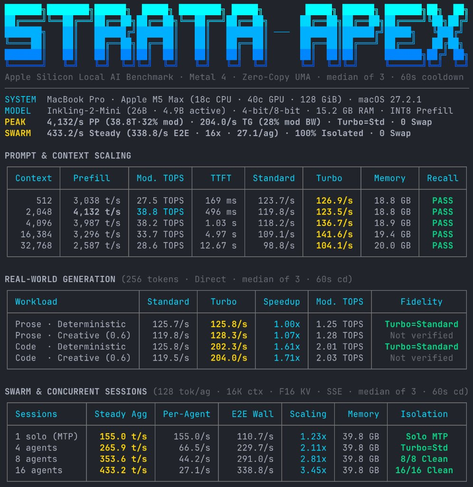

<p align="center">
  
</p>

<p align="center">
  <strong>Native Apple Silicon Metal 4 LLM &amp; Local Agent Swarm Inference Engine</strong>
</p>

Strata Apex is a from-scratch C++20 / Objective-C++ / Metal 4 inference engine built specifically for Apple Silicon unified-memory Macs. It compiles with only Apple Xcode Command Line Tools, links **zero third-party C++ libraries**, and embeds all Metal shaders directly inside a single self-contained `strata-apex` binary.

---

## Highlights

- **Zero-Copy 16 KiB Page-Aligned `.strata` UMA Bundles:** Direct `mmap` → `newBufferWithBytesNoCopy` weight mapping (`0` steady-state major page faults, `0` swap).
- **Persistent `MTLBinaryArchive` Shader Cache:** `0` spill-risk PSOs and `~14 ms` warm startup across all engines.
- **Inkling-2-Mini (26B Looped MoE, ~14.2 GiB fast bundle):**
  - Native 3-layer DSpark Block-8 MTP speculative decoding (`K=0..7`, adaptive `SpecCtl`), dynamic `W=4` Beam Tree verification (`--tree-spec`), 2-Stage Bitplane exact `Q8_0` LM head (`--bitplane-head`), and opt-in Metal 4.1 INT8 NAX prefill (`--int8-prefill`).
  - **Iteration-Level Continuous Batching (`--max-batch 1..64`):** Run 4–32+ concurrent local coding swarm agents in parallel with 100% bit-exact cross-stream isolation and zero solo (`c = 1`) regression.
  - **Native 1M Context (`1,048,576` tokens):** Full FP16 KV and per-head `Q8_0` KV (`--kv-cache q8`), plus multi-slot LRU prefix caching.
  - **Lossless Native Metal Vision Encoder:** Zero-dependency `ImageIO` / `CoreGraphics` + 23-layer ViT (`inkling2_vision.strata`, `~610 MiB`) supporting OpenAI `image_url` payloads.
  - **Single-Server Hot-Swap (`--no-refusal`):** Serves stock and `--no-refusal` variants simultaneously (`+76 MiB` `wo` overlay) with strict KV and prefix-cache isolation.
- **Additional Built-In Frontier MoE Engines:** **Qwen3.8-Flash-Next (180B MoE + NVMe PLE)** and **GLM-5.3-Flash (320B MoE)** with speculative MTP, paged KV, and zero-pause compaction.
- **Built-In `STRATA // APEX` Benchmark (`strata-apex-bench`):** Terminal benchmark cards covering context scaling, NIAH recall, prose/code decode speedups, and live concurrent swarm throughput.

---

## Requirements

- **Apple Silicon Mac** (M5 / M4 recommended for Metal 4 NAX & SME2; Metal 3.1 fallback supported on earlier Apple Silicon)
- **macOS 14 (Sonoma) or newer** (minimum for Metal 3.1 fallback on Inkling-2-Mini, Qwen3.8-Flash-Next, and Qwen3.8-27B; **macOS 26 (Tahoe) or newer** recommended for Metal 4 NAX tensor ops and required for GLM-5.3-Flash; **Xcode Command Line Tools** via `xcode-select --install` for building from source)
- **Unified Memory Recommendations:**

| Mac UMA | Recommended Workloads |
| :--- | :--- |
| **24–32 GB** | Inkling-2-Mini solo (`16K–64K`, `--kv-cache q8`) or 2–4 agent swarms |
| **48–64 GB** | Inkling-2-Mini up to `256K` solo or 4–8 agent swarms (`16K` ctx) |
| **128 GB+** | Inkling-2-Mini up to **1M context** (`--max-seq-len 1048576 --kv-cache q8`) or **16–32 agent swarms**, plus **Qwen3.8-Flash-Next (180B)** & **GLM-5.3-Flash (320B)** |

---

## Install

### Option 1 — Homebrew (Recommended)
```zsh
brew install echobb8/tap/strata-apex
```
*(Formula maintained in [echobb8/homebrew-tap](https://github.com/echobb8/homebrew-tap) and mirrored in [packaging/homebrew/strata-apex.rb](packaging/homebrew/strata-apex.rb).)*

### Option 2 — Prebuilt macOS Apple Silicon Release
Download `strata-apex-0.1.0-macos-arm64.tar.gz` (and its `.sha256`) from [GitHub Releases](https://github.com/echobb8/strata-apex/releases/latest):
```zsh
tar -xzf strata-apex-0.1.0-macos-arm64.tar.gz
cd strata-apex-0.1.0
./strata-apex doctor
```

### Option 3 — Build & Install from Source (Zero External Dependencies)
```zsh
git clone https://github.com/echobb8/strata-apex.git
cd strata-apex
make -j8 cli
make install PREFIX=/opt/homebrew   # installs `strata-apex` and `strata-apex-bench`
```

Verify your Mac's Metal GPU, UMA working-set budget, and recommended presets:
```zsh
strata-apex doctor
```

---

## Quickstart

### 1. Pull & Pack a Model
Requires `hf` / `huggingface-cli` (`brew install huggingface-cli` or `pipx install huggingface_hub`):
```zsh
# Downloads Inkling-2-Mini, converts & repacks to ~14.2 GiB fast bundle + Vision sidecar
strata-apex pull inkling-2-mini

# Optional: download a pre-packed .strata bundle directly from a HuggingFace repo
strata-apex pull inkling-2-mini --bundle-repo <hf-org>/<bundle-repo>
```
Bundles are stored in `~/.cache/strata-apex` (override via `STRATA_APEX_CACHE_DIR`; existing `~/.cache/strata` bundles are auto-detected).

### 2. Serve Solo, 1M Context, or a Local Agent Swarm (OpenAI-Compatible API)
```zsh
# Solo coding server (full MTP7 + Beam Tree + Bitplane speed, 64K context)
strata-apex serve inkling-2-mini

# 8-agent or 16-agent coding swarm (iteration-level continuous batching)
strata-apex serve inkling-2-mini --max-batch 8 --max-seq-len 16384
strata-apex serve inkling-2-mini --max-batch 16 --max-seq-len 16384

# Native 1M context window (per-head Q8_0 KV, ~37 GiB UMA solo)
strata-apex serve inkling-2-mini --max-seq-len 1048576 --kv-cache q8

# Check live health, memory, and active batch size
curl http://127.0.0.1:8080/health
```

### 3. Connect OpenCode (With ~400K Auto-Compaction)
```zsh
# Preview or write ~/.config/opencode/opencode.json
strata-apex setup-opencode --dry-run
strata-apex setup-opencode --context 432768 --output 32768
```
See [docs/opencode.example.json](docs/opencode.example.json) for a full standalone example config.

### 4. Interactive Terminal Chat & Benchmarks
```zsh
# Interactive Inkling-2-Mini REPL
strata-apex chat-inkling2

# Full STRATA // APEX benchmark card (512..32K + Prose/Code + 1..16x Swarm, median of 3)
strata-apex-bench inkling --int8-prefill --runs 3 --cooldown 60 --clear

# Fast Swarm & Concurrent Sessions card only (~15s)
strata-apex-bench inkling --swarm-only --clear
```

---

## Example Benchmark

Generated directly with `strata-apex-bench inkling --int8-prefill --runs 3 --cooldown 60` on a **MacBook Pro · Apple M5 Max (18c CPU · 40c GPU · 128 GiB UMA · macOS 27.2.1)** running **Inkling-2-Mini (26B / 4.9B active · 15.2 GB RAM [14.2 GiB] · INT8 Prefill · median of 3 · 60s cooldown · 0 swap)**:

<p align="center">
  
</p>

| Benchmark | Workload / Config | Standard | Turbo / Steady Agg | Scaling / Notes | Memory | Verification |
| :--- | :--- | :---: | :---: | :--- | :---: | :---: |
| **Prefill Peak** | `2,048` ctx (`INT8` NAX) | — | **4,132 t/s** | `38.8` mod. TOPS (`32%` of `120T` sustained, `496 ms` TTFT) | `18.8 GB` | `PASS` (`5/5` NIAH `512..32K`) |
| **Long-Context Prefill** | `32,768` ctx (`INT8` NAX) | — | **2,587 t/s** | `28.6` mod. TOPS (`12.67 s` TTFT, `104.1/s` decode) | `20.0 GB` | `PASS` (verified to `1M-1`) |
| **Code Decode (Greedy)** | `256` tok · Direct MTP7 | `125.8 t/s` | **202.3 t/s** | `1.61x` (`2.01` mod. TOPS, `30%` mod. BW) | `18.8 GB` | `Turbo=Standard` |
| **Code Decode (T=0.6)** | `256` tok · Direct MTP7 | `119.5 t/s` | **204.0 t/s** | `1.71x` (`2.03` mod. TOPS, `28%` mod. BW = `172.9 GB/s`) | `18.8 GB` | `Not verified` |
| **Swarm · 1 Solo (MTP)** | `128` tok · `16K` ctx · SSE | `125.8 t/s` | **155.0 t/s** | `1.23x` steady decode (`110.7/s` E2E wall) | `39.8 GB` | `Solo MTP` |
| **Swarm · 4 Agents** | `128` tok/ag · `16K` ctx · SSE | — | **265.9 t/s** | `66.5/ag` steady (`229.7/s` E2E wall, `2.11x` vs Std) | `39.8 GB` | `Turbo=Std` (`4/4`) |
| **Swarm · 8 Agents** | `128` tok/ag · `16K` ctx · SSE | — | **353.6 t/s** | `44.2/ag` steady (`291.0/s` E2E wall, `2.81x` vs Std) | `39.8 GB` | `8/8 Clean` |
| **Swarm · 16 Agents** | `128` tok/ag · `16K` ctx · SSE | — | **433.2 t/s** | `27.1/ag` steady (`338.8/s` E2E wall, `3.45x`, `0` swap) | `39.8 GB` | `16/16 Clean` |

> **Notes:** `GB` values are decimal gigabytes (`10^9` bytes). `Mod. TOPS` and `% mod. BW` are analytical models against sustained M5 Max ceilings (`120.0 TOPS` INT8 / `60.0 TOPS` FP16, `614 GB/s` UMA), not hardware counter measurements. Opt-in `--int8-prefill` is approximate and alters generated tokens relative to default FP16 prefill (`Turbo=Standard` verifies bit-exact speculative equivalence after the same prefill). With `--cooldown 60`, 3-run spread stayed within `1.6%` max prefill (`32,768` ctx) and `4.7%` max solo decode (`4,096` Turbo); back-to-back runs without cooldown can vary ~20% on long prefills under sustained thermal load. Swarm `Steady Agg` measures full-overlap decode across all active streams (`10.2%–13.5%` spread at `8x–16x`); `E2E wall` includes request admission and sequential prefill stagger.

---

## Development & Test Suites

```zsh
make -j8 all test_model test_gpu test_hw test_cli
./build/test_model   # 6/6: packer, unbiased FR-Spec Monte Carlo, E8S-18, Q8_0 KV
./build/test_gpu     # 21/21: NAX GEMM, Bitplane, Beam Tree, Continuous Batching, 1M Split-KV
./build/test_hw      # 4/4: SME2 FMOPA, F_NOCACHE QD64 NVMe, 16c ANE probe
./build/test_cli     # End-to-end CLI, Chat REPL, OpenAI Server & Continuous Batching
```

To build a standalone macOS arm64 release archive locally:
```zsh
make dist
```

For deep Apple Silicon architecture notes, see [docs/STRATA_M5_ARCHITECTURE_REPORT.md](docs/STRATA_M5_ARCHITECTURE_REPORT.md).

---

## License

Released under the [MIT License](LICENSE).
